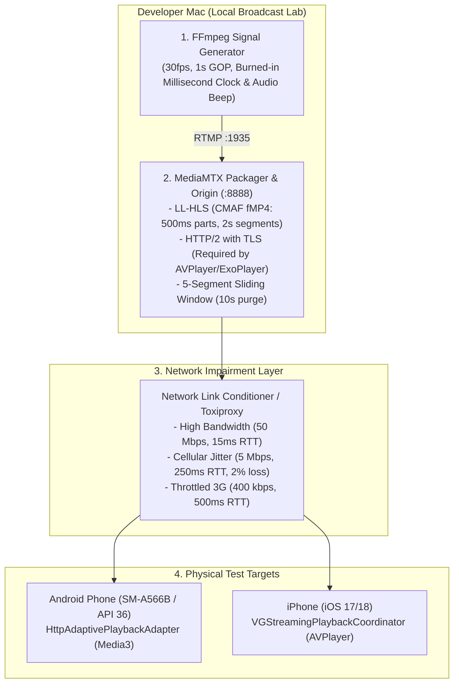
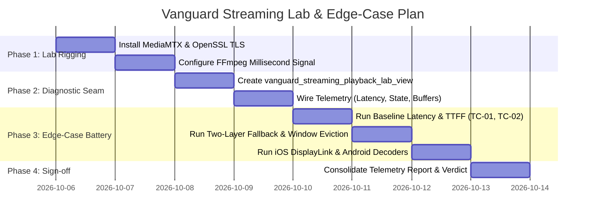

# Vanguard HLS & LL-HLS Test Lab & Edge-Case Implementation Plan

This specification provides the end-to-end blueprint to stand up a local, zero-cloud test laboratory and execute an intensive verification battery over Vanguard's native HLS and LL-HLS playback engines:
- **Android Media3 Engine**: [`HttpAdaptivePlaybackAdapter.kt`](file:///Users/foxy/connects_app/packages/vanguard_media_engine/android/src/main/kotlin/com/connects/vanguard_media_engine/streaming/HttpAdaptivePlaybackAdapter.kt), [`AndroidDagStreamingPlaybackCoordinator.kt`](file:///Users/foxy/connects_app/packages/vanguard_media_engine/android/src/main/kotlin/com/connects/vanguard_media_engine/streaming/AndroidDagStreamingPlaybackCoordinator.kt), and [`AdaptiveStreamLiveOffsetPolicy.kt`](file:///Users/foxy/connects_app/packages/vanguard_media_engine/android/src/main/kotlin/com/connects/vanguard_media_engine/streaming/AdaptiveStreamLiveOffsetPolicy.kt).
- **iOS AVPlayer Engine**: [`VGStreamingPlaybackCoordinator.swift`](file:///Users/foxy/connects_app/packages/vanguard_media_engine/ios/Classes/VGStreamingPlaybackCoordinator.swift).
- **Flutter App Bridge**: [`AppVanguardVideoPlayerController`](file:///Users/foxy/connects_app/connectsapp_app/lib/app/shared/media/playback/vanguard/app_vanguard_video_player_controller.dart) and [`AppVanguardVideoPlayerView`](file:///Users/foxy/connects_app/connectsapp_app/lib/app/shared/media/playback/vanguard/app_vanguard_video_player_view.dart).

---

## 1. Local Lab Architecture (Zero-Cloud)

Testing low-latency streaming requires simulating an active broadcast server on your local developer machine. Static VOD playlists cannot test live edge tracking, sliding window evictions, or partial segment chunking.



### Lab Component Configuration

#### Component A: MediaMTX Low-Latency Packager
Install MediaMTX:
```bash
brew install mediamtx
```

Generate local self-signed TLS certificates (both iOS AVPlayer and Android Media3 reject cleartext HTTP/2 for LL-HLS):
```bash
openssl req -x509 -newkey rsa:2048 -keyout server.key -out server.crt -days 365 -nodes -subj "/CN=localhost"
```

Save `mediamtx.yml`:
```yaml
hls: yes
hlsAddress: :8888
hlsServerKey: server.key
hlsServerCert: server.crt
hlsAlwaysRemux: yes
hlsVariant: lowLatency              # Enables Apple LL-HLS CMAF part chunking
hlsSegmentDuration: 2s              # Full segment boundary
hlsPartDuration: 500ms              # Low-latency sub-segment duration
hlsSegmentCount: 5                  # Rolling sliding window: 10s total depth
```

#### Component B: FFmpeg Live Signal Generator with Precision Timecode
Broadcast a simulated vertical live stream (720x1280 @ 30fps) with an exact millisecond clock and audio sync tone:
```bash
ffmpeg -re -f lavfi -i testsrc=size=720x1280:rate=30 \
  -vf "drawtext=text='VANGUARD LAB %{pts\:hms}.%{eif\:mod(n*1000/30,1000)\:d\:3}':rate=30:fontsize=44:fontcolor=yellow:box=1:boxcolor=black@0.7:x=40:y=100" \
  -f lavfi -i "sine=frequency=1000:duration=0.05,adelay=950|950" \
  -c:v libx264 -preset ultrafast -tune zerolatency -g 30 -keyint_min 30 -sc_threshold 0 -b:v 2500k \
  -c:a aac -b:a 128k -ar 44100 \
  -f flv rtmp://localhost:1935/live/test
```
*Live Edge URL:* `https://<YOUR_MAC_IP>:8888/live/test/index.m3u8`

---

## 2. In-App Diagnostic Test Seam (Flutter)

To observe the native engines in real time on physical hardware, create a dedicated diagnostic harness view in `connectsapp_app`:
`connectsapp_app/lib/app/module/connects_livestream/vanguard_streaming_playback_lab_view.dart`.

### Features of the Diagnostic Harness
1. **Live Glass-to-Glass Latency Display**: Displays local device time side-by-side with video clock.
2. **Buffer Depth & Jitter Telemetry**: Real-time readouts of `bufferedPositionMs`, `positionMs`, and `liveOffsetMs`.
3. **Engine State Inspection**: Reports native lifecycle states (`opening`, `buffering`, `playing`, `seeking`, `failed`).
4. **Interactive Profile Switcher**: On-the-fly toggling between:
   - `VGStreamingNetworkProfile.lowLatency` (LL-HLS: 3s buffer, 500ms parts)
   - `VGStreamingNetworkProfile.stable` (Standard HLS: 15s–50s buffer)
   - `VGStreamingNetworkProfile.constrained` (Low-bandwidth fallback: 25s buffer, 800 kbps cap)

```dart
// Diagnostic Seam Usage
final controller = AppVanguardVideoPlayerController.networkUrl(
  Uri.parse('https://192.168.1.50:8888/live/test/index.m3u8'),
  formatHint: VGStreamingFormatHint.hls,
  networkProfile: VGStreamingNetworkProfile.lowLatency,
  autoPlay: true,
);
```

---

## 3. The 8-Tier Edge-Case Test Battery

| Tier | Edge Case | Target Engine | Trigger / Impairment | Pass Criteria |
| :--- | :--- | :--- | :--- | :--- |
| **TC-01** | **Time-to-First-Frame (TTFF)** | Android & iOS | Cold start stream open | TTFF $< 900\text{ ms}$; no audio pre-burst |
| **TC-02** | **Glass-to-Glass Latency** | Android & iOS | High-bandwidth baseline | Delay between video clock and device $\le 2.5\text{ s}$ |
| **TC-03** | **Two-Layer Adaptive Fallback** | Android Media3 | Throttle 10 Mbps $\to$ 400 kbps | Drops from 500ms parts to 2s segments without crashing |
| **TC-04** | **Live Window Eviction** | Android Media3 | 5s total Wi-Fi disconnect | Catches `BehindLiveWindowException`, seeks to edge |
| **TC-05** | **UI Main Thread Starvation** | iOS AVPlayer | 60fps Flutter chat animations | `CADisplayLink` frame pump retains 30fps without desync |
| **TC-06** | **Audio Pitch Preservation** | Android Media3 | Buffer catch-up at $1.03\times$ speed | Voice pitch remains natural (WSOLA active; no chipmunk) |
| **TC-07** | **Foreground / Background Resume** | iOS & Android | 15s app background / lock | Resumes at live edge; does NOT play 15s stale VOD buffer |
| **TC-08** | **Hardware Decoder Exhaustion**| Android & iOS | Rapid vertical swipe (10 streams) | Surfaces released immediately; 0 `MediaCodec` memory leaks |

---

### Detailed Test Procedures

#### TC-01: Cold-Start Time-to-First-Frame (TTFF)
- **Objective:** Measure latency from `controller.initialize()` until the first pixel renders on the Flutter `Texture`.
- **Procedure:**
  1. Trigger stream open via `controller.initialize()`.
  2. Record timestamp $T_0$.
  3. Listen for first frame via `controller.addListener` when `value.renderedFrames > 0`. Record $T_{\text{first}}$.
- **Pass Criteria:**
  - $T_{\text{first}} - T_0 \le 900\text{ ms}$ on Wi-Fi/5G.
  - Audio and video render synchronously on frame 1.

#### TC-02: Glass-to-Glass Latency
- **Objective:** Verify LL-HLS meets TikTok-style interactive live streaming latency requirements ($1.5\text{s} - 2.5\text{s}$).
- **Procedure:**
  1. Point the phone camera at the Mac screen showing FFmpeg's running terminal clock.
  2. Take a high-speed photo capturing both the Mac screen time and the phone screen video time.
  3. Subtract Video Milliseconds from Mac Terminal Milliseconds.
- **Pass Criteria:**
  - Total glass-to-glass delay is between **1,500ms and 2,500ms**.

#### TC-03: Two-Layer Adaptive Latency Fallback (LL-HLS $\to$ HLS)
- **Objective:** Verify that when bandwidth collapses, the player smoothly transitions to standard HLS rather than dying in an infinite buffer loop.
- **Procedure:**
  1. Start stream under `VGStreamingNetworkProfile.lowLatency`.
  2. Use Network Link Conditioner to drop bandwidth to 350 kbps with 300ms RTT.
  3. Observe Media3 / AVPlayer segment requests in proxy logs.
- **Pass Criteria:**
  - Player playhead naturally slips past the 3-second live window.
  - Requests transition from `_HLS_msn=X&_HLS_part=Y` to standard `.m4s` full 2-second segments.
  - Playback continues with zero app crash or fatal error.

#### TC-04: Sliding Window Eviction & 404/410 Handling
- **Objective:** In a strict 10-second sliding window, segments older than 10 seconds are purged. If a client stalls for 12 seconds, requested segments return HTTP 404/410.
- **Procedure:**
  1. Stream running on device.
  2. Disconnect Wi-Fi for 12 seconds.
  3. Reconnect Wi-Fi.
- **Pass Criteria:**
  - Media3 catches `BehindLiveWindowException`.
  - Android [`AdaptiveStreamTimelineController`](file:///Users/foxy/connects_app/packages/vanguard_media_engine/android/src/main/kotlin/com/connects/vanguard_media_engine/streaming/AdaptiveStreamTimelineController.kt) triggers `REBASED` status.
  - Player seeks directly to the current live edge without requiring manual app restart.

#### TC-05: iOS `CADisplayLink` & Main-Thread Contention
- **Objective:** [`VGStreamingPlaybackCoordinator.swift`](file:///Users/foxy/connects_app/packages/vanguard_media_engine/ios/Classes/VGStreamingPlaybackCoordinator.swift) pumps video frames to Flutter textures via `CADisplayLink` on the Main Thread.
- **Procedure:**
  1. Play LL-HLS stream on an iPhone.
  2. Spawn an intense Flutter animation overlay (e.g. 50 floating animated gift particles + high-speed chat list scroll).
  3. Inspect Xcode Instruments (Time Profiler & Core Animation).
- **Pass Criteria:**
  - Video presentation rate stays steady at $\ge 28\text{ fps}$.
  - Main thread CPU usage from `VGStreamingPlaybackCoordinator.onDisplayLink` remains $< 8\%$.
  - Audio and video stay in lip-sync.

#### TC-06: Audio Pitch Preservation under Live Speed Adjustment
- **Objective:** In [`AdaptiveStreamLiveOffsetPolicy.kt`](file:///Users/foxy/connects_app/packages/vanguard_media_engine/android/src/main/kotlin/com/connects/vanguard_media_engine/streaming/AdaptiveStreamLiveOffsetPolicy.kt), playback speed ramps between $0.97\times$ and $1.03\times$ to track the live edge.
- **Procedure:**
  1. Broadcast continuous human speech with background music.
  2. Inject minor 400ms network jitter to trigger speed catch-up to $1.03\times$.
  3. Listen critically to the audio output.
- **Pass Criteria:**
  - Voice pitch must remain normal (time-stretching active via WSOLA/Sonic).
  - No chipmunk effect or metallic robotic audio artifacts.

#### TC-07: Backgrounding & Lock Screen Re-Entry
- **Objective:** Ensure the player does not silently turn into a delayed VOD player after app interruption.
- **Procedure:**
  1. Stream playing actively at 2s live latency.
  2. Lock device screen for 20 seconds.
  3. Unlock device.
- **Pass Criteria:**
  - Player resumes playback within 1.0 second.
  - Video playhead snaps immediately to the live edge ($\le 2.5\text{s}$ latency).
  - Player does **not** resume from the 20-second-old paused point.

#### TC-08: Rapid Vertical Swiping & Hardware Decoder Garbage Collection
- **Objective:** Mobile chipsets (Snapdragon, MediaTek, Apple Silicon) enforce hard limits on concurrent hardware video decoders (typically 4–8 instances).
- **Procedure:**
  1. Embed `AppVanguardVideoPlayerView` in a vertical `PageView`.
  2. Swipe rapidly through 15 simulated live stream items (1 swipe every 300ms).
  3. Monitor Android `adb logcat | grep -i mediacodec` and iOS Xcode memory footprint.
- **Pass Criteria:**
  - Zero `CodecException: Error 0xfffffff4` (No free hardware decoders).
  - Detached pages immediately call `controller.dispose()`, releasing the native `Surface` and `MediaCodec` instance.
  - Total graphics memory stays flat.

---

## 4. Execution Roadmap



### Sign-off Milestones
1. **Lab Readiness:** MediaMTX serving live fMP4 chunks with valid HTTP/2 TLS certificates verified via `curl -I --http2 https://localhost:8888/live/test/index.m3u8`.
2. **Android Baseline:** `SM-A566B` achieving $< 2.5\text{s}$ glass-to-glass latency with zero `BehindLiveWindowException` crashes.
3. **iOS Baseline:** iPhone physical device maintaining stable 30fps `CADisplayLink` frame delivery without main-thread jitter.
4. **Adaptive Resilience Verified:** Physical proof of graceful degradation from low latency to standard buffer under cellular throttling.
